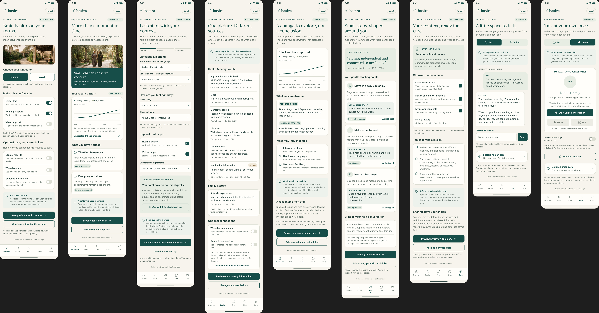

# Basira — Kuda+Lumi Health Companion

Basira is a mobile-first wellbeing-reflection prototype. It brings user-entered check-ins, cognitive-practice observations, and supportive conversations into one place so people can organize what they may want to discuss with a professional.

> **Non-diagnostic prototype.** Basira is not a medical device, validated cognitive assessment, diagnosis, risk score, or substitute for a clinician or emergency service. Demo cases and sample data are fictional. The app does not monitor emergencies or submit real referrals. For sudden or urgent concerns, contact local emergency or clinical services directly.

## What works in this prototype

- English and Arabic interfaces, with preferences for larger text, hearing support, and vision support.
- User-entered mood, sleep, walking, and wellbeing check-ins, plus cognitive-practice activities. Practice results are for familiarization only—not screening.
- A longitudinal review of saved observations with descriptive, uncertainty-aware wording; it does not infer a diagnosis from a pattern.
- Text chat and an optional consent-based voice check-in. The voice check-in uses speech recognition; raw audio is not saved by that flow.
- An encrypted local store and an in-app option to delete the local profile.
- A clinician-facing walkthrough with fictional cases. It is not authenticated clinician review and is not connected to a care service.

## Interface preview



*Illustrative product-flow/reference screens with example data—not a capture of a live clinical service. Connected records, wearables, genomic data, and real referral actions are not active features.*

## Demo video

[Watch the Basira demo video](https://youtube.com/shorts/97uvQDAIGoU?feature=share)

## Run locally

### Requirements

- Flutter SDK with Dart 3.3 or later.
- A supported Flutter target (for example, an Android/iOS device or emulator).

### Install and launch

```bash
git clone https://github.com/elishachitate-sketch/health-companion.git
cd health-companion
flutter pub get
flutter run
```

Run the automated Flutter tests with:

```bash
flutter test
```

Some platform features, including microphone access and encrypted local storage, depend on the target platform and its permissions.

## Optional AI and backend services

The app's text-chat service uses the configured Health Companion Worker endpoint. To override the default endpoint for a local run:

```bash
flutter run --dart-define=HEALTH_COMPANION_WORKER_URL=https://<your-worker-host>
```

Voice chat requires a separately configured voice gateway. Set `BASIRA_VOICE_GATEWAY_URL` as a Dart define when running the app. Keep provider credentials such as `GROQ_API_KEY` on the server—in Cloudflare Worker secrets or Firebase Functions secrets—and never commit them to the repository.

For deployment details, see [the Worker integration notes](ai/voice-chat-gateway.md), [the Groq integration notes](ai/groq-integration.md), and [the Firebase Functions package](functions/).

## Safety and scope

This prototype currently reflects information entered by the user. It is not connected to electronic health records, wearables, blood-pressure or laboratory devices, family-history services, or genomic services. Its synthetic routing and scoring components are examples only; they are not validated for clinical decisions. Do not enter real patient-identifiable or other sensitive health information into the demo.

See [challenge readiness and claim boundaries](docs/challenge_readiness.md) and the [MVP brief](product/mvp-brief.md) for the intended scope and evaluation needs before any clinical use.
